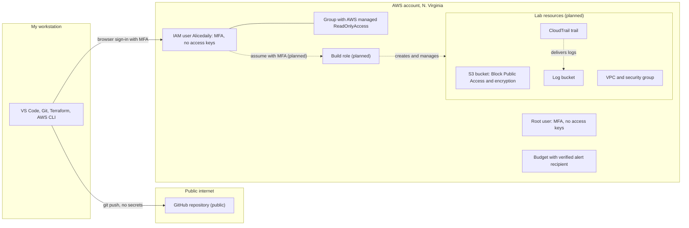

# Architecture

Solid lines and boxes are in place today. Dashed lines and boxes marked "planned" are not built yet.

## Components

| Component | Purpose | Status |
|---|---|---|
| Root user | Account-level tasks only. MFA enabled and no active access keys. | Observed. It is still used for IAM changes until a build role exists. |
| IAM user `Alicedaily` | Everyday read-only login with MFA and no access keys. | Tested: listing buckets was allowed and creating one was denied. |
| Group with ReadOnlyAccess | Carries the user's permissions, so they are managed in one place. | Configured and tested through the user. |
| Build role | A narrowly scoped role that Terraform runs under, assumed with MFA. | Planned. |
| Lab resources | S3 bucket, network and logging built from Terraform. Weak settings are introduced on purpose, then found, fixed and retested. | Planned. |
| Budget | A $5 monthly budget with one verified recipient. | Configured. Alert delivery not tested. |
| GitHub repository | The public record of the project. | In place. Secrets are blocked by `.gitignore` rules, and screenshots are checked by hand. |

## Trust boundaries
1. **Public internet and the repository:** anything committed is public and permanent in history.
2. **Workstation and the AWS account:** sign-in with MFA today. Command-line access will go through an assumed role, with no stored access keys.
3. **Inside the account:** root, the read-only user and the build role have different powers. The build role is the only one meant to create resources.

## Decisions
- [ADR-001: everyday identity](decisions/001-everyday-identity.md)
- - [ADR-002: build role for Terraform](decisions/002-build-role.md) (proposed, not yet tested)
## Limits
- This is a single-account lab with no real customer data.
- Nothing in the lab section exists yet. It will be added to this page as it is built and tested.
- Network details beyond the default VPC have not been reviewed.